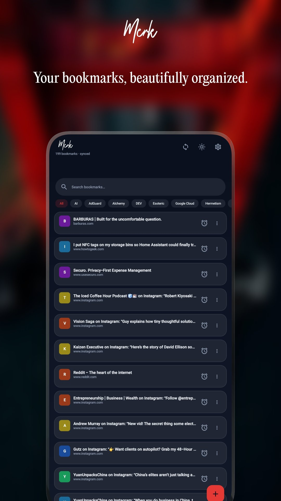
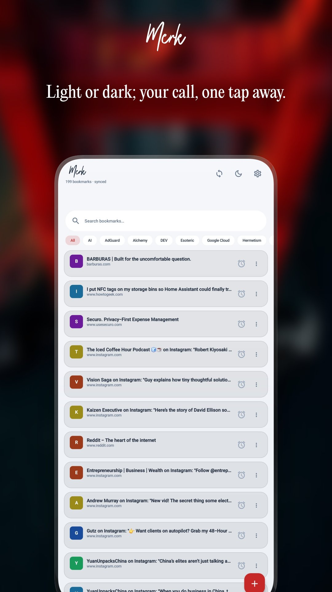
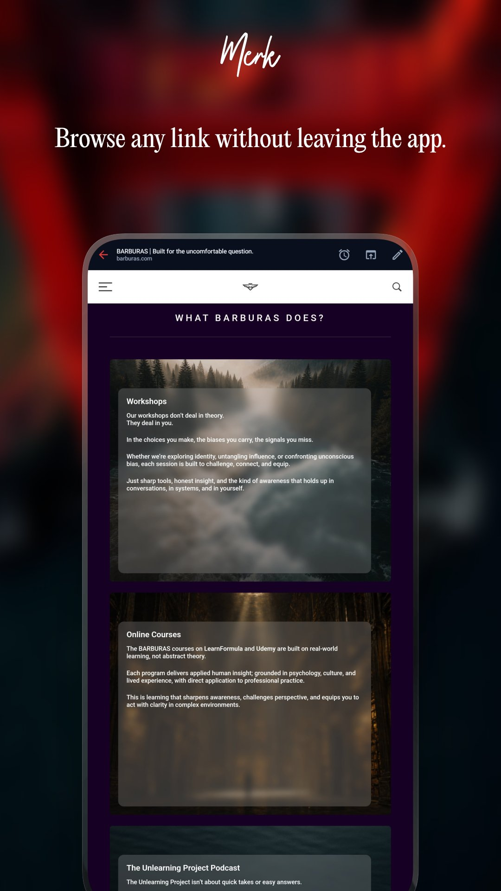
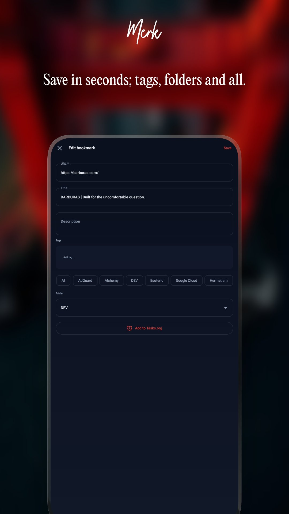
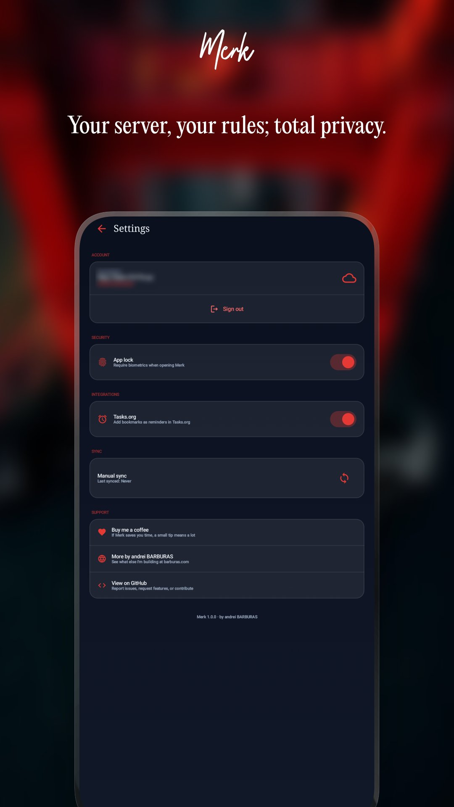

# Merk

**A beautiful Nextcloud Bookmarks client for Android.**

Merk connects to your own Nextcloud server to save, organize, and browse your bookmarks — privately, offline-first, and without any third-party cloud.

  
  
  
  
  

---

## Screenshots

| # | Screen | Caption |
|---|--------|---------|
| 01 | Bookmark list — dark mode | Your bookmarks, beautifully organized. |
| 02 | Bookmark list — light mode | Light or dark; your call, one tap away. |
| 03 | In-app browser | Browse any link without leaving the app. |
| 04 | Add / edit bookmark | Save in seconds; tags, folders and all. |
| 05 | Settings | Your server, your rules; total privacy. |

---

## Features

- **Bookmark list** — instant search, tag chips, favicon initials, colored letter fallbacks
- **In-app browser** — browse bookmarks without switching apps; open in external browser anytime
- **Share target** — share any URL from Chrome or any app directly to Merk
- **Add & edit** — title, description, tags, folder picker, create new folders on the fly
- **Nextcloud sync** — Login Flow v2 authentication, offline-first with Room, auto-sync on save/delete
- **Tasks.org integration** — turn any bookmark into a reminder with one tap
- **Biometric lock** — fingerprint or PIN protection
- **Light & dark mode** — one-tap toggle right in the app

---

## Requirements

- Android 8.0 (API 26) or higher
- A [Nextcloud](https://nextcloud.com) instance with the [Bookmarks app](https://apps.nextcloud.com/apps/bookmarks) installed

---

## Tech stack

- Kotlin + Jetpack Compose + Material 3
- Hilt (dependency injection)
- Room (offline-first local database)
- OkHttp + 'org.json' (no Retrofit — avoids R8 obfuscation issues)
- DataStore (settings & auth persistence)
- Coil (favicon loading)
- WorkManager / coroutines

---

## Building

'''bash
git clone https://github.com/andreibarburas/merk-android.git
cd merk-android
./gradlew assembleDebug
'''

No API keys or special configuration needed. On first launch, enter your Nextcloud server URL to authenticate via Login Flow v2.

---

## About Author

Hi, I'm [Andrei Barburas](https://barburas.com). By day, I work at the intersection of information management, intelligence gathering, and human cyber risk; designing systems that make sense of complexity and surface what usually stays unseen, drawing on a background in counter-terrorism research and the behavioral patterns behind radicalization and digital vulnerability. I also lecture in Ethics, Communication Management, and Cross-Cultural Management, and write and teach courses on psychology, culture, and critical thinking.

This corner of GitHub is the other side of that same instinct. I build a small collection of free, open-source tools for people who self-host: a suite of [Android Apps](https://github.com/stars/andreibarburas/lists/android-apps) designed around Nextcloud and selfhosters, along with [Home Assistant Apps](https://github.com/andreibarburas/hassio-apps) and a handful of [Wordpress Plugins](https://github.com/andreibarburas/lists/wordpress-plugins).

I started making these because I wanted something the existing options didn't offer; small, focused tools that fit my own self-hosted setup instead of forcing me to compromise. No ads, no tracking, GPLv3 licensed where applicable, and built to work with the tools people already run at home.

## AI Usage

I'm open about the fact that I use AI throughout development. It genuinely helps me move faster and build things I wouldn't otherwise have time for as one person. But AI doesn't replace the actual work; I still spend the evenings figuring out what something should actually do, testing it against real setups and edge cases, and tracking down the inevitable weird bugs. AI is a tool I use, not a shortcut around the thinking.

## Support

If my work saves you time, a small tip means a lot:

- **Donate:** [bunq.me/barburasdonations](https://bunq.me/barburasdonations?description=Donation%20from%20Github)
- **GitHub Sponsors:** [github.com/sponsors/andreibarburas](https://github.com/sponsors/andreibarburas)
- **Website:** [barburas.com](https://barburas.com)
- **Issues & feature requests:** [open an issue](https://github.com/andreibarburas/merk-android/issues)

## Links

- [Play Store](https://play.google.com/store/apps/dev?id=6842866278906089090)
- [r/BarburasLab](https://reddit.com/r/barburaslab)
- [Privacy Policy](https://barburas.com/privacy-policy/)

## Other work on Github

- [Android Apps](https://github.com/stars/andreibarburas/lists/android-apps)
- [Home Assistant Apps](https://github.com/andreibarburas/hassio-apps)
- [Wordpress Plugins](https://github.com/stars/andreibarburas/lists/wordpress-plugins)

## License

All my work is licensed under the [GNU General Public License v3.0](LICENSE).

You are free to use, study, modify, and redistribute this software, provided that any distributed modifications are also licensed under GPL v3 and the source code remains available.

---

*by [andrei BARBURAS](https://barburas.com)*